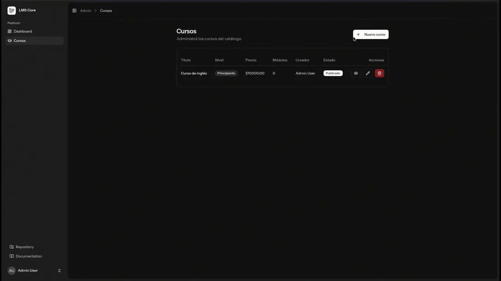
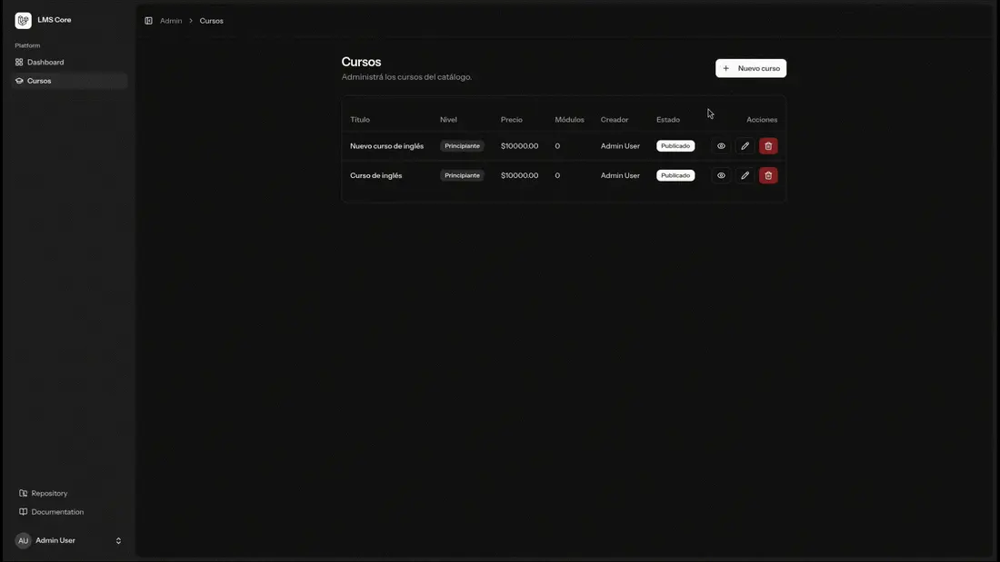
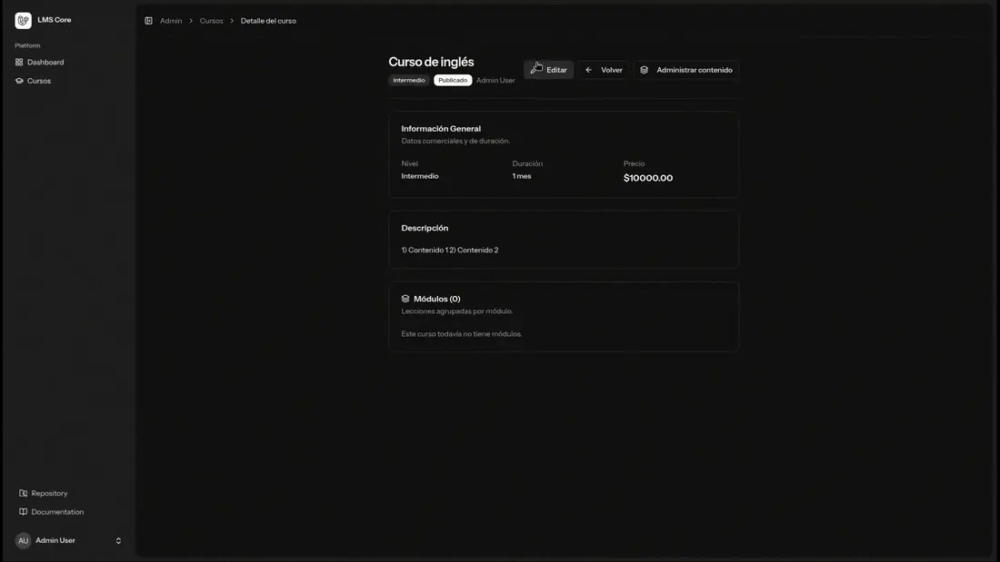
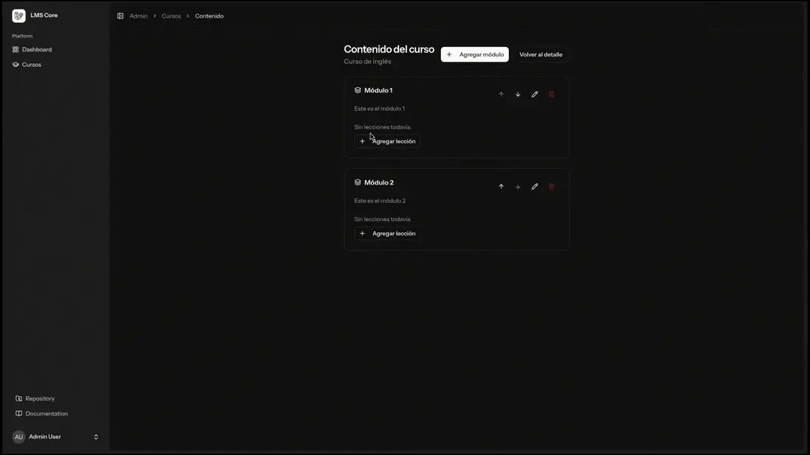
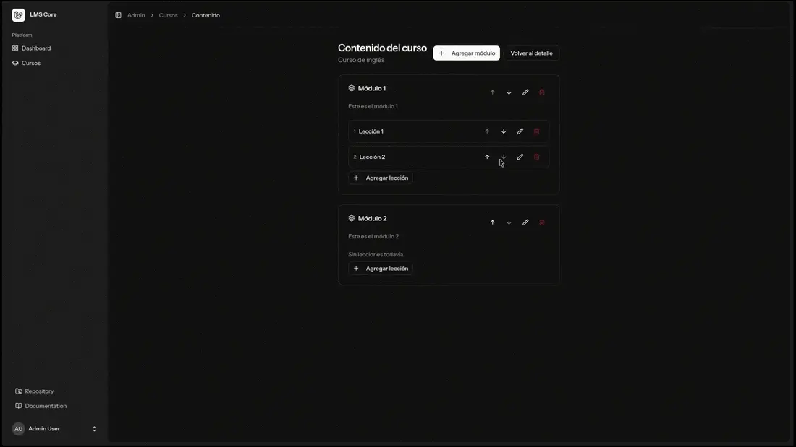
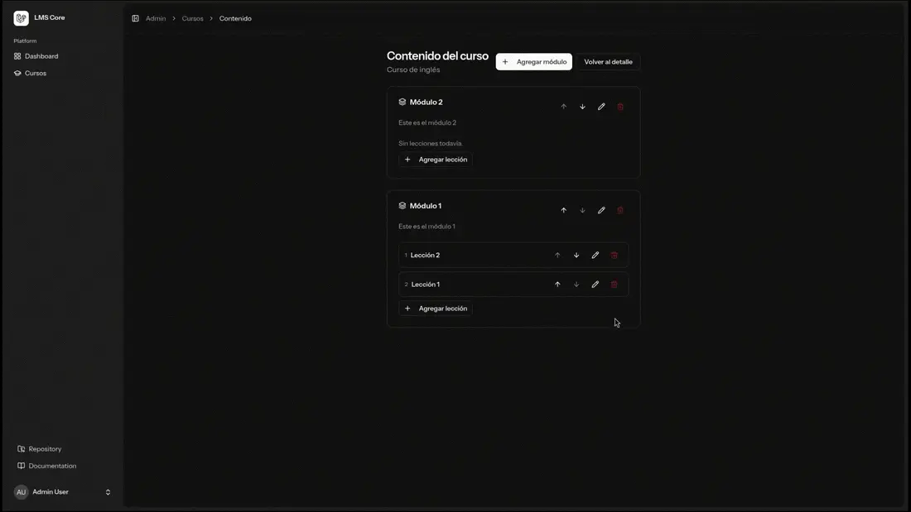

# LMS Core — Panel de administración de cursos

Plataforma para gestionar el ciclo de vida de cursos online: creación, edición,
publicación y organización del contenido en módulos y lecciones, con
autenticación (incluido Google OAuth) y autorización por roles.

> Repositorio de portafolio: es un recorte de un proyecto real, congelado a modo
> de caso de estudio. No es un producto en mantenimiento activo.

## Funcionalidades

- **Gestión de cursos**: alta, edición, publicación como borrador/publicado y
  borrado lógico, con generación automática de `slug` único.
- **Builder de contenido**: módulos y lecciones con modales, ordenación ↑↓ y
  borrado en cascada coherente.
- **Autorización por roles**: `student`, `teacher` y `admin`, con una política
  centralizada por curso.
- **Autenticación**: email/contraseña (Fortify) y OAuth con Google, con
  vinculación de cuentas existentes por email.
- **Prevención de dobles acciones**: los formularios bloquean envíos duplicados y
  no se cierran durante una operación en curso.

## Demo

Grabaciones del flujo principal (WebP animado).

**1. Crear un curso**



**2. Editar un curso**



**3. Crear y editar un módulo**



**4. Añadir lecciones**



**5. Editar y reordenar módulos y lecciones**



**6. Eliminar lecciones, módulos y cursos**



## Stack

- **Backend:** PHP 8.4+, Laravel, Fortify, Socialite
- **Frontend:** React 19, Inertia, TypeScript, Tailwind CSS, shadcn/ui
- **Base de datos:** SQLite por defecto (cero configuración) · PostgreSQL opcional (DDEV) · SQLite en memoria en los tests
- **Herramientas:** Vite, Wayfinder, DDEV, PHPUnit, Pint, Larastan, ESLint, Prettier

## Arquitectura y decisiones

El modelo de dominio, el flujo de autorización y las decisiones de diseño con sus
trade-offs están documentados en [`docs/arquitectura.md`](docs/arquitectura.md).

Resumen rápido:

- Autorización centralizada en `App\Policies\CoursePolicy` (dueño del curso + rol).
- Cascada de borrado lógico implementada con eventos de modelo (`deleting`/`restoring`).
- Rutas tipadas de Laravel → TypeScript gracias a Wayfinder.
- ~1.000 líneas de feature tests sobre los caminos críticos (CRUD, autorización,
  ordenación y OAuth).

## Puesta en marcha

### Requisitos

- [DDEV](https://ddev.com/) (recomendado) o, en su lugar, PHP 8.4+, Composer y
  Node.js. No hace falta un servidor de base de datos: por defecto usa SQLite.

### Con DDEV

```bash
ddev start
ddev composer install
ddev npm install
cp .env.example .env
ddev artisan key:generate
ddev artisan migrate --seed
ddev npm run build
```

La aplicación queda disponible en la URL que imprime `ddev start`.

### Sin DDEV

```bash
composer install
npm install
cp .env.example .env
php artisan key:generate
php artisan migrate --seed
npm run build
php artisan serve
```

### Usuarios de demo

Los seeders crean usuarios listos para probar. Contraseña: **`password`** en todos.

| Email                 | Rol     | Qué puede hacer                                                                 |
| --------------------- | ------- | ------------------------------------------------------------------------------- |
| `teacher@example.com` | teacher | Gestionar sus cursos y el builder de contenido (ya trae un curso demo cargado). |
| `admin@example.com`   | admin   | Ver y gestionar todos los cursos.                                               |

El seeder crea además 10 usuarios `student` (acceso solo a su panel).

## Cómo usarlo

1. Iniciá sesión con un usuario demo.
2. `teacher` o `admin` entran al panel en `/admin/dashboard`. Desde **Cursos** pueden:
   - **crear** un curso (el `slug` se genera solo si lo dejás vacío),
   - abrir el **builder de contenido** (`/admin/courses/{id}/content`),
   - **añadir módulos y lecciones**, reordenarlos con las flechas ↑↓ y borrarlos
     (borrado lógico en cascada).
3. Un `student` solo accede a su panel; las rutas de administración le quedan bloqueadas.

Flujo pensado para la demo: **crear curso → añadir módulos → añadir lecciones → reordenar.**

## Tests y calidad

```bash
# Backend
ddev artisan test          # o: php artisan test
ddev composer lint:check   # Pint
ddev composer types:check  # Larastan / PHPStan

# Frontend
npm run lint:check
npm run format:check
npm run types:check
```

Los tests corren aislados sobre SQLite en memoria (`phpunit.xml`), así que no
tocan la base de datos de desarrollo.

> Nota: los tipos de rutas de Wayfinder se generan al compilar (`npm run build`)
> o con `php artisan wayfinder:generate --with-form`. Hay que generarlos antes de
> `npm run types:check` en un clon recién bajado.

## Estructura del proyecto

```
app/
├── Enums/             # UserRole, CourseLevel
├── Http/
│   ├── Controllers/   # Admin (Course/Module/Lesson) y Auth (Google)
│   ├── Middleware/    # RoleMiddleware, HandleInertiaRequests, …
│   └── Requests/      # Validación y autorización
├── Models/            # Course, Module, Lesson, User, Profile
└── Policies/          # CoursePolicy
database/
├── factories/         # Datos de prueba
├── migrations/        # Esquema
└── seeders/           # Datos iniciales
docs/
└── arquitectura.md
resources/js/
├── pages/admin/courses/   # Builder y CRUD (React)
└── components/            # UI compartida
tests/Feature/Admin/       # Tests de dominio
```

## Licencia

Todos los derechos reservados. Publicado como muestra de portafolio; no se concede
permiso de reutilización, redistribución ni uso comercial. Ver [`LICENSE`](LICENSE).
